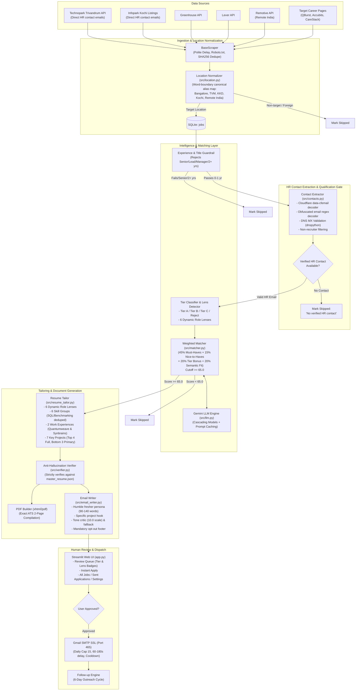

# 🏗️ JobPilot Architecture Specification

## 1. System Overview

**JobPilot** is an autonomous, local-first, human-in-the-loop job search and outreach platform engineered for early-career AI/ML engineers. The platform is configured specifically for **Aswin P T** (M.Sc. Computer Science in Machine Intelligence, 2026), with real experience in **computer vision (drone/surveillance), LLM/RAG/agentic applications, document AI, federated/graph ML, and FastAPI/Django backends**.

The system enforces six core architectural tenets:
1. **100% Free Technology Stack**: Zero paid API dependencies. Built with Google Gemini free-tier (cascading models + SQLite caching), pure-Python `xhtml2pdf` + Jinja2, SQLite3, `dnspython`, and Gmail SMTP SSL.
2. **Strict Regional Constraints**: Ingestion is restricted to **Bangalore / Bengaluru**, **Thiruvananthapuram (TVM)**, **Kozhikode (KKD)**, **Kochi**, and **Remote India**. Non-target Indian metros and foreign locations are discarded at ingestion.
3. **Fresher Experience Tier**: Strictly limits applications to freshers and candidates with 0–1 years experience. Automatically disqualifies roles demanding 2+ years or titles bearing senior/lead/manager prefixes.
4. **Mandatory HR Contact Gate**: Any job posting lacking a verified recruiter or HR contact email is **strictly avoided and skipped**. Outreach drafts and resumes are only generated when a valid, MX-verified recipient email exists.
5. **Zero-Hallucination Resume Verifier**: All tailored resume claims, skills, bullet points, and project details are verified against the candidate's canonical `master_resume.json`. Any invented claims are strictly purged before compilation.
6. **Humble Fresher Tone Engineering**: Cold outreach emails are generated with a humble, polite persona tailored for an entry-level engineer (90–140 words, specific project citation, no pushy sales pitches, mandatory opt-out footer).

---

## 2. High-Level Architecture Diagram



---

## 3. Core Component Breakdown

### 3.1. Ingestion Subsystem (`src/scrapers/`, `src/location.py`)
- **`BaseScraper` (`src/scrapers/base.py`)**: Abstract base class providing SHA256 URL hashing for deduplication, randomized polite request spacing (2–5 seconds), RFC `robots.txt` compliance checking, and HTML stripping.
- **Kerala IT Park Scrapers (`src/scrapers/kerala_parks.py`)**:
  - `TechnoparkScraper`: Ingests live job postings from the official Technopark Trivandrum API (`https://technopark.in/api/paginated-jobs`). Resolves company names and extracts direct recruiter contact emails (`contact_email`) embedded within the Inertia.js job details page.
  - `InfoparkScraper`: Queries Infopark Kochi career listings (`https://infopark.in/companies-job`), parsing company vacancies and extracting direct HR contact emails from company detail pages.
- **Greenhouse & Lever Scrapers (`src/scrapers/greenhouse.py`, `src/scrapers/lever.py`)**: Pulls structured postings from target tech company boards (Thoughtworks, Inmobi, Slice, Meesho, CRED).
- **Location Normalizer (`src/location.py`)**: A dedicated module using compiled regex word-boundary matching and canonical alias dictionaries:
  - `bangalore`: Bangalore, Bengaluru, BLR, Koramangala, Whitefield, Electronic City, Manyata, Bellandur, Sarjapur, etc.
  - `thiruvananthapuram`: Thiruvananthapuram, Trivandrum, TVM, Technopark, Kazhakkoottam.
  - `kozhikode`: Kozhikode, Calicut, KKD, Cyberpark, Hilite City.
  - `kochi`: Kochi, Cochin, Ernakulam, Infopark, Kakkanad, SmartCity.
  - `remote_india`: Remote - India, Remote in India, India Remote, Anywhere in India.
  - Non-target locations (Mumbai, Delhi, Pune, London, New York, US-Remote, Worldwide) are strictly rejected.

### 3.2. HR Contact Extraction & Qualification Subsystem (`src/contacts.py`)
- **Multi-Method Email Mining**:
  - Cloudflare Obfuscation: Automatically decodes Cloudflare protected emails (`data-cfemail` hex decoding).
  - Obfuscated Text Regex: Detects patterns like `name [at] domain [dot] com` or `name(at)domain.com`.
  - RFC Regex Parsing: Scans job description text and crawls company `/careers`, `/contact`, and `/about` pages.
- **DNS MX Validation**: Uses `dnspython` to query authoritative DNS nameservers for active mail exchange (`MX`) records on target domains, filtering out invalid or defunct domains.
- **Strict Non-Recruiter Filtering**: Automatically rejects non-hiring addresses (`accommodations@`, `privacy_candidates@`, `support@`, `billing@`, `press@`, `ir@`, `compliance@`, `security@`).
- **Mandatory HR Contact Gate**: Any job lacking a valid, verified recruiter/HR email is disqualified and marked `skipped`. This ensures the candidate's review queue is populated only with actionable opportunities.

### 3.3. Experience Guardrails & Weighted Matcher (`src/matcher.py`, `src/jd_parser.py`)
- **Fast Title Pre-Screener**: Disqualifies titles containing `senior`, `lead`, `manager`, `director`, `head of`, `principal`, `architect`, `vp`, or multi-year counters (`2+`, `3+`, `5+`), expending 0 LLM tokens.
- **0–1 Year Experience Rule**: `is_fresher_or_under_1_year()` evaluates experience statements, rejecting any role demanding 2 or more years.
- **Role Tiering**:
  - **Tier A (Score Bonus +20)**: Computer Vision, Drone Analytics, AI/ML Engineer, Applied ML, GenAI / RAG / Agent Developer.
  - **Tier B (Score Bonus +10)**: Document AI, Medical AI, Junior Data Scientist, AI Research Assistant, Federated / Graph ML.
  - **Tier C (Score Bonus 0)**: Python Backend (FastAPI / Django) with AI integration, Software Engineer (AI team).
  - **Reject**: Pure frontend, QA, DevOps-only, non-technical, or 2+ years experience.
- **6 Dynamic Role Lenses**:
  - `computer_vision_drone`: Prioritizes drone intrusion detection (`p1`) and audio-visual deepfake detection (`p4`).
  - `genai_rag_agent`: Prioritizes enterprise agentic RAG (`p3`) and Manglish conversational agent (`p5`).
  - `document_ai_nlp`: Prioritizes medical document information extraction (`p2`) and agentic RAG (`p3`).
  - `federated_graph_ml`: Prioritizes privacy-preserving federated GNN (`p7`) and deepfake detection (`p4`).
  - `backend_ai_fastapi`: Prioritizes AI storefront backend (`p6`) and agentic RAG (`p3`).
  - `generic_ai_ml`: Dynamic selection based on JD keyword overlap.
- **Weighted Scoring Formula**:
  $$\text{Score} = (0.45 \times \text{Must-Haves}) + (0.15 \times \text{Nice-to-Haves}) + \text{Tier Bonus} + (0.20 \times \text{Semantic Fit})$$
  Roles with $\text{Score} \ge 65.0$ qualify for resume tailoring and email drafting.

### 3.4. Token Guardrails & Cascading LLM Engine (`src/llm.py`)
- **Model Cascading**: Automatically falls back through active Gemini models (`gemini-3.5-flash-lite` -> `gemini-3.5-flash` -> `gemini-3.7-flash` -> `gemini-3.8-flash`) if any individual model hits rate limits or quota caps.
- **SQLite LLM Cache**: SHA256 hashes prompts; identical calls are served from `llm_cache` with 0ms latency and 0 API cost.
- **Daily Budget Counter**: Tracks request and token totals in `llm_usage` against configured limits (350,000 tokens / 250 requests daily).

### 3.5. Pixel-Faithful Resume Tailor & Adaptive Fit Engine (`src/resume_tailor.py`, `src/pdf_builder.py`)
- **Reference Resume Match (`templates/resume.html`)**:
  - Pixel-faithful clone of `Aswin_P_T_Reference.pdf` built using core `Times-Roman` and `Times-Bold` typography.
  - **Page 1**: Left-aligned Name (`18pt Bold`), Headline (`13.4pt Regular` tailorable by role lens), Contact block (`10pt` with bold labels), `PROFESSIONAL SUMMARY:` (~5–6 lines paragraph), `TECHNICAL SKILLS:` (6 categories in canonical order, bold labels, de-duplicated), `EXPERIENCE :` (**Quantumweave Intelligence** 5 bullets, **Synbrains Solutions** 3 bullets with `•` hanging indent), `EDUCATION:` (**M.Sc.** and **B.Sc.** complete on Page 1).
  - **Page 2**: Forced page break $\rightarrow$ `PROJECTS :` (**all 7 projects** with bold title, ` · ` middle-dot tech stack, and authentic bullets).
- **The Deterministic 12-Iteration Fit Engine (`fit_to_two_pages`)**:
  - Dynamically measures text bounding boxes via PyMuPDF (`fitz`):
    $$\text{fill} = \frac{\text{max\_y} - \text{margin\_top}}{\text{usable\_height}}$$
  - Targets: Page count = 2, `fill_page1` $\in [0.93, 1.00]$, `fill_page2` $\in [0.93, 1.00]$, with Education completely on Page 1.
  - Automatically tunes spacing, font size, and trims/expands bullets to ensure both pages are fully filled with zero awkward whitespace gaps or overflow.
- **Zero-Hallucination Verifier (`src/verifier.py`)**: Asserts that every skill, employer, degree, date, and project in the output exists in `master_resume.json`. Any hallucinated content is automatically rejected.
- **Pure-Python PDF Engine**: Uses `xhtml2pdf` to render standard vector PDFs on Windows without GTK/C-DLL dependencies.

### 3.6. Cold Outreach Email Writer (`src/email_writer.py`)
- **Humble Fresher Persona**: Generates polite, concise cold outreach (90–140 words) acknowledging early-career status, referencing relevant company tech and specific candidate projects, and avoiding aggressive sales language.
- **Tone Scoring Critic**: Evaluates generated text against an automated 10.0 rubric:
  - Penalizes pushy phrases (*"look no further"*, *"perfect candidate"*, *"hit the ground running"*, *"I can guarantee"*).
  - Rewards humble markers (*"eager to learn"*, *"would welcome the opportunity"*, *"open to guidance"*).
  - Enforces word count limits (90–140 words).
  - Falls back to a deterministic, polite template if LLM output fails tone criteria.
- **Mandatory Opt-Out Footer**:
  > *"If this isn't the right contact, let me know and I won't follow up."*

### 3.7. Human Review UI & Dispatch Subsystem (`app.py`, `src/sender.py`, `src/followup.py`)
- **Streamlit Web Dashboard**: Provides a 6-tab interface with live badges for Role Tier (Tier A/B/C), Detected Role Lens, Verified Recruiter Email, Match Score, and Tone Score.
- **Gmail SMTP SSL (Port 465)**: Native `smtplib` delivery using an encrypted SSL tunnel with candidate's Gmail App Password.
- **Safety Controls**: Enforces a 15-email daily cap, 60–180 second randomized delays, 9 AM–6 PM sending hours, 30-day company cooldowns, and a permanent opt-out blocklist.
- **Follow-up Engine**: Automatically schedules a single polite follow-up 6 days after initial dispatch.

### 3.7. Company Discovery & Speculative Outreach Engine (`src/companies/`)
Operates as an independent, parallel discovery engine finding companies directly rather than solely reacting to posted job openings:
- **Phase A (Discovery)**: Harvests target companies in Bangalore, Thiruvananthapuram, Kochi, Kozhikode, and Remote India via Kerala IT parks (Technopark & Infopark), public ATS boards, GitHub organizations, and curated seed lists. Deduplicates entries using canonical domain normalizers and fuzzy string matching.
- **Phase B (Size Enrichment & 20/50 Rule)**: Uses a 5-level evidence ladder (Level 1: Official/self-reported regexes, Level 2: Kerala Park directories, Level 3: Wikidata P1128 & schema.org, Level 4: Hiring volume proxy, Level 5: Team page proxy). Assigns `confirmed_20plus`, `likely_20plus`, `unknown`, or `under_20`. Never presents estimates as fact.
- **Phase C (Deterministic Scoring)**: Evaluates field fit using weighted keyword profiles (3.0 for CV/drone/LLM, 2.0 for DocAI/Graph ML, 1.0 for general ML/FastAPI). Scores hiring signals and city priority, assigning Tiers A, B, C, or Excluded.
- **Phase D (Contact Harvesting)**: Crawls `/careers`, `/contact`, `/about`, and `/team` pages, decodes Cloudflare obfuscation, parses `mailto:` links, performs DNS MX verification, and ranks contacts.
- **Phase E (Speculative Application Engine)**: Identifies dominant role lens, generates a pseudo-JD, tailors a 2-page resume with zero fabrication, and writes a humble speculative cold email (90–140 words, opt-out footer, tone critic >= 8.5/10).

---

## 4. Database Schema Specification (`data/jobpilot.db`)

```sql
-- Companies discovered and enriched
CREATE TABLE companies (
    id INTEGER PRIMARY KEY AUTOINCREMENT,
    name TEXT NOT NULL,
    domain TEXT UNIQUE,
    website TEXT,
    careers_url TEXT,
    city TEXT,
    address TEXT,
    hq_country TEXT,
    employee_min INTEGER,
    employee_max INTEGER,
    employee_estimate INTEGER,
    size_confidence REAL DEFAULT 0.0,
    size_source TEXT,
    size_evidence TEXT,
    size_status TEXT DEFAULT 'unknown', -- confirmed_20plus | likely_20plus | unknown | under_20
    field_tags TEXT,                    -- JSON array of matched tags
    field_fit_score REAL DEFAULT 0.0,
    hiring_signal_score REAL DEFAULT 0.0,
    company_score REAL DEFAULT 0.0,
    tier TEXT DEFAULT 'excluded',       -- A | B | C | excluded
    discovered_via TEXT,
    last_checked TIMESTAMP,
    status TEXT DEFAULT 'new',
    notes TEXT,
    created_at TIMESTAMP DEFAULT CURRENT_TIMESTAMP,
    updated_at TIMESTAMP DEFAULT CURRENT_TIMESTAMP
);

-- Company signals captured over time
CREATE TABLE company_signals (
    id INTEGER PRIMARY KEY AUTOINCREMENT,
    company_id INTEGER NOT NULL,
    signal_type TEXT NOT NULL,          -- field_keyword | open_role | tech_blog | github | funding | team_page | park_directory
    value TEXT NOT NULL,
    source_url TEXT,
    weight REAL DEFAULT 1.0,
    captured_at TIMESTAMP DEFAULT CURRENT_TIMESTAMP,
    FOREIGN KEY (company_id) REFERENCES companies(id) ON DELETE CASCADE
);

-- Speculative and company outreach records
CREATE TABLE company_outreach (
    id INTEGER PRIMARY KEY AUTOINCREMENT,
    company_id INTEGER NOT NULL,
    contact_id INTEGER,
    mode TEXT DEFAULT 'speculative',    -- job_application | speculative
    resume_path TEXT,
    email_subject TEXT,
    email_body TEXT,
    status TEXT DEFAULT 'drafted',      -- drafted | approved | sent | replied | skipped
    sent_at TIMESTAMP,
    followup_due TIMESTAMP,
    followup_sent INTEGER DEFAULT 0,
    created_at TIMESTAMP DEFAULT CURRENT_TIMESTAMP,
    updated_at TIMESTAMP DEFAULT CURRENT_TIMESTAMP,
    FOREIGN KEY (company_id) REFERENCES companies(id) ON DELETE CASCADE,
    FOREIGN KEY (contact_id) REFERENCES contacts(id) ON DELETE SET NULL
);

-- Discovered jobs
CREATE TABLE jobs (
    id TEXT PRIMARY KEY,
    company_id INTEGER,
    title TEXT NOT NULL,
    company TEXT NOT NULL,
    location TEXT,
    url TEXT UNIQUE NOT NULL,
    description TEXT NOT NULL,
    posted_date TEXT,
    source TEXT DEFAULT 'manual',
    recruiter_email TEXT,
    role_tier TEXT,
    role_lens TEXT,
    created_at TIMESTAMP DEFAULT CURRENT_TIMESTAMP,
    FOREIGN KEY (company_id) REFERENCES companies(id) ON DELETE SET NULL
);

-- Recruiter & HR contacts
CREATE TABLE contacts (
    id INTEGER PRIMARY KEY AUTOINCREMENT,
    job_id TEXT NOT NULL,
    company_id INTEGER,
    email TEXT NOT NULL,
    name TEXT,
    role TEXT,
    source_type TEXT DEFAULT 'jd_text',
    verified INTEGER DEFAULT 0,
    domain_mx_valid INTEGER DEFAULT 0,
    created_at TIMESTAMP DEFAULT CURRENT_TIMESTAMP,
    FOREIGN KEY (job_id) REFERENCES jobs(id) ON DELETE CASCADE
);

-- Tailored applications and dispatch state
CREATE TABLE applications (
    id INTEGER PRIMARY KEY AUTOINCREMENT,
    job_id TEXT UNIQUE NOT NULL,
    resume_path TEXT,
    tailored_json_path TEXT,
    email_subject TEXT,
    email_body TEXT,
    status TEXT DEFAULT 'new', -- new, matched, drafted, approved, sent, replied, failed, skipped
    match_score REAL DEFAULT 0.0,
    role_tier TEXT,
    role_lens TEXT,
    rationale TEXT,
    layout_warning INTEGER DEFAULT 0,
    page_fill TEXT,
    sent_at TIMESTAMP,
    followup_due TIMESTAMP,
    followup_sent INTEGER DEFAULT 0,
    created_at TIMESTAMP DEFAULT CURRENT_TIMESTAMP,
    updated_at TIMESTAMP DEFAULT CURRENT_TIMESTAMP,
    FOREIGN KEY (job_id) REFERENCES jobs(id) ON DELETE CASCADE
);

-- Blocklist for recruiter opt-outs
CREATE TABLE blocklist (
    id INTEGER PRIMARY KEY AUTOINCREMENT,
    email TEXT UNIQUE NOT NULL,
    reason TEXT,
    created_at TIMESTAMP DEFAULT CURRENT_TIMESTAMP
);

-- Token & request quota tracker
CREATE TABLE llm_usage (
    usage_date TEXT PRIMARY KEY,
    request_count INTEGER DEFAULT 0,
    prompt_tokens INTEGER DEFAULT 0,
    completion_tokens INTEGER DEFAULT 0,
    total_tokens INTEGER DEFAULT 0,
    updated_at TIMESTAMP DEFAULT CURRENT_TIMESTAMP
);

-- LLM prompt-response cache
CREATE TABLE llm_cache (
    prompt_hash TEXT PRIMARY KEY,
    response_text TEXT NOT NULL,
    created_at TIMESTAMP DEFAULT CURRENT_TIMESTAMP
);

-- Structured audit logging
CREATE TABLE logs (
    id INTEGER PRIMARY KEY AUTOINCREMENT,
    level TEXT DEFAULT 'INFO',
    module TEXT NOT NULL,
    message TEXT NOT NULL,
    timestamp TIMESTAMP DEFAULT CURRENT_TIMESTAMP
);
```

---

## 5. Technology Stack Summary

| Layer | Technology | License / Cost | Why Chosen |
| :--- | :--- | :--- | :--- |
| **Language** | Python 3.14 / 3.11+ | Open Source | Standard, extensible, cross-platform |
| **LLM Provider** | Google Gemini API | 100% Free Tier | High quality, 15 RPM free, multi-model cascading |
| **PDF Generation** | `xhtml2pdf` + `Jinja2` | Open Source | Pure-Python HTML-to-PDF, zero Windows C DLL dependencies |
| **Database** | SQLite3 | Built-in | Zero configuration, ACID-compliant, local persistence |
| **Web UI** | Streamlit | Open Source | Rapid interactive Python UI with zero JS build step |
| **Email Transport** | `smtplib` + SSL (465) | Built-in | Direct Gmail App Password integration, zero third-party relay |
| **DNS Validation** | `dnspython` | Open Source | Direct MX record validation preventing email bounces |
| **HTML Scraping** | `requests` + `BeautifulSoup4` | Open Source | Fast, reliable parsing of career boards and portals |
| **Browser Engine** | `Playwright` | Open Source | Headless Chrome fallback for JavaScript-rendered SPAs |
