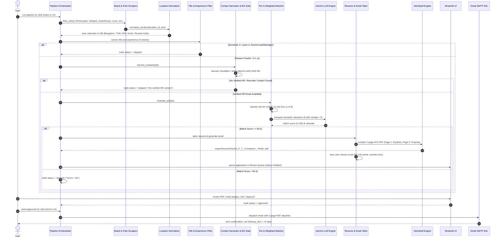

# 🔄 JobPilot Pipeline Specification

## 1. Overview of the Pipeline Flow

The JobPilot pipeline executes an autonomous, end-to-end job discovery, qualification, tailoring, and outreach loop. Each stage is decoupled and can be run independently via CLI commands or operated through the Streamlit web dashboard.

---

## 2. Detailed Pipeline Stages

### Stage 1: Multi-Source Job Discovery & Scraping (`python -m src.pipeline scrape`)
1. **Target Data Sources**:
   - **Kerala IT Parks**:
     - `TechnoparkScraper`: Ingests live job postings from the official Technopark Trivandrum API (`https://technopark.in/api/paginated-jobs`). Resolves company details and extracts direct HR contact emails.
     - `InfoparkScraper`: Queries Infopark Kochi vacancies (`https://infopark.in/companies-job`) and extracts direct company HR contacts.
   - **ATS Portals**: Greenhouse (`inmobi`, `groww`, `thoughtworks`, `canonical`, `slice`) and Lever (`meesho`, `palantir`, `cred`).
   - **Remote India**: Remotive remote engineering feeds filtered for India.
   - **Company Portals**: Direct career page scrapers for regional IT firms (QBurst, Accubits, CareStack).
2. **Polite Spacing & Deduplication**: Enforces 2–5 second randomized delays between HTTP requests, checks RFC `robots.txt`, and generates a deterministic SHA256 ID from the posting URL to ensure zero duplicate entries in SQLite.

### Stage 2: Canonical Location Normalization (`src/location.py`)
- Ingested location strings are normalized by stripping punctuation and splitting multi-location strings (`Bangalore; Hyderabad; Pune` or `Hybrid - Bangalore`).
- Matches each component using compiled **word-boundary regular expressions** against canonical alias maps:
  - `bangalore`: Bangalore, Bengaluru, BLR, Koramangala, Whitefield, Electronic City, Manyata, Bellandur, Sarjapur.
  - `thiruvananthapuram`: Thiruvananthapuram, Trivandrum, TVM, Technopark, Kazhakkoottam.
  - `kozhikode`: Kozhikode, Calicut, KKD, Cyberpark, Hilite City.
  - `kochi`: Kochi, Cochin, Ernakulam, Infopark, Kakkanad, SmartCity.
  - `remote_india`: Remote - India, Remote in India, India Remote, Anywhere in India.
- Any posting located in non-target metros (Mumbai, Delhi NCR, Pune, Hyderabad, Chennai) or foreign locations (US, UK, EMEA, Singapore) is immediately marked `skipped` with rationale `"Location outside target region"`.

### Stage 3: Title & Experience Pre-Screening
- **Fast Title Inspection**: Inspects the job title against senior keywords:
  `["senior", "sr.", "sr ", "lead", "staff", "principal", "architect", "manager", "director", "head of", "vp", "vice president", "3+", "4+", "5+", "6+", "7+", "8+"]`
  Unless the title also explicitly contains *junior*, *intern*, or *trainee*, the job is immediately marked `skipped` with **zero LLM tokens expended**.
- **0–1 Year Experience Detection (`is_fresher_or_under_1_year`)**: Regular expressions scan requirements for multi-year constraints (`2+ years`, `3-5 years`, `minimum 2 years`). If detected, the role is disqualified immediately.

### Stage 4: Mandatory Recruiter Contact Harvesting & Qualification Gate (`src/contacts.py`)
- **Extraction Techniques**:
  - Direct API field mining (e.g. `contact_email` on Technopark jobs).
  - Cloudflare `data-cfemail` hex decoding.
  - Obfuscated email regex decoding (`name [at] domain [dot] com`).
  - RFC regex scanning of JD text and company `/careers`, `/contact`, `/about` pages.
- **DNS MX Verification**: Queries authoritative DNS servers via `dnspython` to verify that target mail exchange servers exist and accept email.
- **Strict Non-Recruiter Filtering**: Automatically rejects non-hiring addresses (`accommodations@`, `privacy_candidates@`, `support@`, `billing@`, `press@`, `ir@`, `compliance@`).
- **MANDATORY HR CONTACT GATE**:
  > **Crucial Rule**: If no verified recruiter/HR email is found, the job is immediately marked `skipped` with rationale:
  > `"Skipped: No verified HR / recruiter contact email available for outreach"`
  > It **never** proceeds to resume tailoring or email drafting. This ensures that 100% of applications in the candidate's review queue are directly actionable.

### Stage 5: Role Tier & Lens Classification (`src/matcher.py`)
- **Role Tiering**:
  - **Tier A (Score Bonus +20)**: Computer Vision, Drone Analytics, AI/ML Engineer, Applied ML, GenAI / RAG / Agent Developer.
  - **Tier B (Score Bonus +10)**: Document AI, Medical AI, Junior Data Scientist, AI Research Assistant, Federated / Graph ML.
  - **Tier C (Score Bonus 0)**: Python Backend (FastAPI / Django) with AI integration, Software Engineer (AI team).
  - **Reject**: Pure frontend, QA, DevOps-only, non-technical, or demanding 2+ years.
- **6 Dynamic Role Lenses**:
  - `computer_vision_drone`: Emphasizes drone intrusion detection (`p1`) and audio-visual deepfake detection (`p4`).
  - `genai_rag_agent`: Emphasizes enterprise agentic RAG (`p3`) and Manglish conversational agent (`p5`).
  - `document_ai_nlp`: Emphasizes medical document information extraction (`p2`) and agentic RAG (`p3`).
  - `federated_graph_ml`: Emphasizes privacy-preserving federated GNN (`p7`) and deepfake detection (`p4`).
  - `backend_ai_fastapi`: Emphasizes AI storefront backend (`p6`) and agentic RAG (`p3`).
  - `generic_ai_ml`: Dynamic keyword-driven ordering.

### Stage 6: Technical Matching & Weighted Scoring (`python -m src.pipeline match`)
- **Deterministic Skill Overlap**: Cross-references must-have skills with `master_resume.json`. If 0 overlap, the role is skipped with 0 LLM calls.
- **Semantic Evaluation**: For technically relevant roles, Gemini analyzes JD context and returns semantic fit and technical rationale.
- **Weighted Scoring Formula**:
  $$\text{Score} = (0.45 \times \text{Must-Haves}) + (0.15 \times \text{Nice-to-Haves}) + \text{Tier Bonus} + (0.20 \times \text{Semantic Fit})$$
- **Cutoff**: Roles scoring **$\ge 65.0$** qualify for tailoring (`status = 'matched'`). Roles below 65 are marked `status = 'skipped'`.

### Stage 7: Role-Lens Resume Tailoring & Verification (`src/resume_tailor.py`, `src/verifier.py`)
- **Lens-Specific Assembly**:
  - Selects and reorders bullet points for the 2 real industry experiences (**Quantumweave Intelligence** & **Synbrains Solutions**) by relevance to the detected lens.
  - Selects and reorders the **7 projects**: top 4 projects receive complete bullet descriptions; bottom 3 projects receive primary summary bullet.
  - De-duplicates multi-category skills (e.g. *SQL* and *Model benchmarking* appear once on output).
- **Anti-Hallucination Verification**: Cross-references every skill, tool, company name, degree, and metric against `master_resume.json`. Any invented or ungrounded claims are automatically purged.

### Stage 8: Exact 2-Page ATS PDF Compilation (`src/pdf_builder.py`, `templates/resume.html`)
- **Strict 2-Page Structure**:
  - **Page 1**: Header, Contact Links, Professional Summary (tailored via lens), Technical Skills (6 categories), Professional Experience (Quantumweave & Synbrains), Education (M.Sc. Computer Science in Machine Intelligence, Digital University Kerala; B.Sc. Computer Science, Calicut University).
  - **Page 2**: Key Projects (top 4 full-bullet projects, bottom 3 primary-bullet projects).
- **Pure-Python Rendering**: Compiled using `xhtml2pdf` to `output/resumes/Aswin_P_T_<Company>_<Role>.pdf`.

### Stage 9: Humble Fresher Email Generation (`src/email_writer.py`)
- **Tone Engineering**:
  - Concise length: strictly **90–140 words**.
  - Humble, polite fresher voice: avoids arrogant sales pitches (*"perfect fit"*, *"hit the ground running"*), emphasizes genuine excitement, eagerness to learn, and relevant hands-on projects.
  - References the specific company and cites a matching project.
- **Tone Scoring Critic**: Automatically grades draft quality on a 10.0 scale. If LLM output fails tone rules, automatically switches to a deterministic, polite template.
- **Mandatory Opt-Out Footer**:
  > *"If this isn't the right contact, let me know and I won't follow up."*
- Transitions application to `status = 'drafted'`.

### Stage 10: Human Review & Safe Dispatch (`app.py`, `src/sender.py`)
- **Review Queue**: Candidate reviews drafted application in the Streamlit UI, inspecting Role Tier, Role Lens, Verified Recruiter Email badge, Match Score, Tone Score, and PDF preview.
- **Approval Gate**: Candidate clicks **"✅ Approve Application"**, moving status to `status = 'approved'`.
- **Live Dispatch (`python -m src.pipeline send-approved`)**: Connects to Gmail SMTP SSL (port 465), enforces polite spacing (60–180s delay), checks daily caps (15/day), attaches the 2-page PDF, and schedules follow-up in +6 days.

---

## 3. Diagnostics & Funnel Reporting (`python -m src.pipeline diagnose`)

The pipeline includes a dedicated diagnostic command (`python -m src.pipeline diagnose`) that audits the full pipeline funnel and outputs findings to `output/diagnosis.md`:
1. **Scrape Funnel Report**:
   $$\text{Fetched} \longrightarrow \text{Has Location} \longrightarrow \text{Passed Location Filter} \longrightarrow \text{Passed Experience Filter} \longrightarrow \text{Stored}$$
   Logs the exact rejection reasons and raw location strings for all rejected postings.
2. **Contact Funnel Report**:
   $$\text{Matched Jobs} \longrightarrow \text{Emails in JD} \longrightarrow \text{Domain Resolved} \longrightarrow \text{Pages Crawled} \longrightarrow \text{Emails Found} \longrightarrow \text{MX Valid} \longrightarrow \text{Usable}$$
3. **Tone Quality Audit**: Prints recent cold outreach emails with their automated tone scores and word counts.

---

## 4. Anti-Spam & Operational Safeguards

| Safeguard | Configuration Setting | Implementation |
| :--- | :--- | :--- |
| **Mandatory HR Contact Gate** | Pipeline filter | Automatically skips jobs lacking verified recruiter emails; never drafts blind emails. |
| **Daily Email Cap** | `sending.daily_cap = 15` | Halts dispatch once 15 emails are sent in a calendar day. |
| **Polite Delay** | `sending.delay_min/max = 60-180s` | Randomized sleep between consecutive SMTP connections. |
| **Sending Hours** | `sending_hours = 9 to 18` | Limits email dispatch to normal working hours (9 AM - 6 PM). |
| **Company Cooldown** | `cooldown_days = 30` | Prevents re-emailing the same company within 30 days. |
| **Blocklist Check** | `table: blocklist` | Immediately aborts dispatch if recipient email is on blocklist. |
| **Single Follow-up** | `followup_sent = 1` | Never sends more than one follow-up per application. |

---

## 5. LLM Token & Quota Management

- **Cascading Models**: If `gemini-3.8-flash` hits rate limits, the engine cascades across `gemini-3.5-flash-lite`, `gemini-3.5-flash`, and `gemini-3.7-flash`.
- **SHA256 Prompt Caching**: Identical prompts are served directly from SQLite `llm_cache` with zero API cost.
- **Rule-Based Pre-Filters**: Fast keyword checks on titles and experience reject ineligible jobs before invoking the LLM.
- **Input Truncation**: Removes legal boilerplate and trims JD text to 3,000 characters before LLM ingestion.
