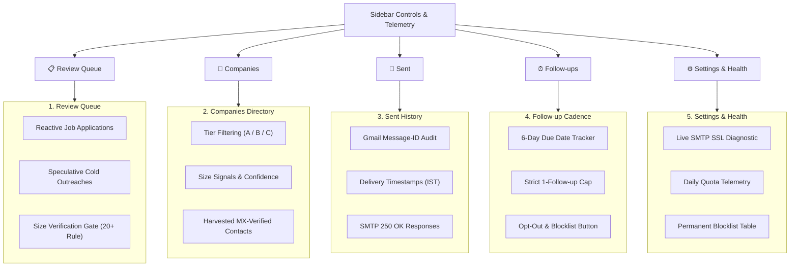

# 🖥️ JobPilot: User Interface & Navigation Guide

This document provides a comprehensive walkthrough of the **JobPilot Streamlit Dashboard (`app.py`)**, explaining every screen, metric, badge, button, and navigation flow.

JobPilot’s UI is designed with a **Human-in-the-Loop** philosophy: it prepares tailored resumes, drafts personalized cold emails, and monitors sending guardrails, but **never dispatches an email without your explicit review and approval**.

---

## 🗺️ High-Level Navigation Architecture



---

## 🧭 1. Sidebar: Controls & Live Telemetry

The left sidebar is persistent across all pages and gives you real-time visibility into quota consumption, sending limits, and pipeline controls.


### 1.1 Quota & Counter Widgets
- **Emails Today (`X / 15`)**: Displays how many emails have left your Gmail account today against the hard daily ceiling of 15 emails. Both job applications and speculative emails share this counter.
- **LLM Calls (`X / 250`)**: Tracks the number of calls made to the Gemini API today against the configured safety limit (250 requests/day).
- **Token Quota Progress Bar**: Displays total estimated token consumption (e.g. `24,500 / 350,000 tokens`). Prevents running into Google's free-tier rate limits.

### 1.2 Radio Navigation
Allows one-click switching between the five main screens:
1. `📋 Review Queue`
2. `🏢 Companies`
3. `🚀 Sent`
4. `⏰ Follow-ups`
5. `⚙️ Settings & Health`

### 1.3 Quick Pipeline Actions
- **`Scrape New`**: Triggers crawlers across configured public boards (Technopark, Infopark, Greenhouse, Lever, etc.) with polite 2–5s delays.
- **`Match & Draft`**: Evaluates newly scraped postings against `master_resume.json`, filters out roles scoring under 65%, and tailors exact 2-page ATS resumes and cover emails.
- **`🏢 Run Company Engine`**: Discovers companies across Bangalore, Trivandrum, Kochi, and Kozhikode, estimates size, checks MX records, and drafts speculative applications.
- **`🚀 Run Auto-Pilot Now`**: Runs an end-to-end cycle (Scrape $\rightarrow$ Match $\rightarrow$ Tailor $\rightarrow$ Queue for review).

---

## 📋 2. Screen 1: Review Queue (`📋 Review Queue`)

The primary workspace where you inspect, edit, and approve every candidate outreach before it leaves your Gmail account.

### 2.1 Dispatch Worker & Schedule Telemetry Bar
Located at the top of the Review Queue:
- **Worker Status**: Displays `🟢 Active` when the background delivery thread is running, or `⚪ Idle` when resting.
- **Approved in Queue**: Total count of items you approved that are waiting for dispatch.
- **Worker Dispatched**: Count of `X sent / Y failed` in the current session.
- **Sending Hours (IST)**: Shows `✅ Window Open` between 09:00 and 18:00 IST. Outside this window, it displays `⏰ Outside Hours` and displays the exact time remaining until 09:00 IST.

---

### 2.2 Section A: Active Job Applications (Reactive Engine)

Shows applications generated for specific posted job openings.

#### Left Column: Job & Resume Telemetry
- **Role Title & Company**: Highlights the role, company name, and location.
- **Match Score Badge**:
  - `🟢 85-100%`: Strong match (Tier A)
  - `🟡 68-84%`: Good match (Tier B)
  - `🔴 < 68%`: Low match (filtered out by default)
- **Role Lens**: Displays which lens was selected (e.g. `Computer Vision / Drone`, `LLM / GenAI / RAG`, `Document AI`).
- **Match Rationale**: Brief justification explaining why your profile fits this exact job.
- **Vertical Page Fill**: Shows page fill percentage (e.g. `Page 1: 96.1% | Page 2: 93.5%` with `✅ Exact 2-Page Fit`).
- **⬇️ Download Tailored PDF**: Generates and downloads the exact ATS PDF that will be attached to the email.
- **View Tailored JSON Structure**: An expandable tree showing structured sections (experience bullets, projects, skills).

#### Right Column: Email Editor & Approval Buttons
- **Recipient Recruiter Email**: Editable field populated with the discovered public HR contact.
- **Subject Line**: Tailored subject referencing the role and candidate name.
- **Body Editor**: 90–150 word cold email draft adhering to the zero-flattery rule and containing the mandatory opt-out footer.
- **Action Buttons**:
  - `💾 Save Edits`: Saves any edits made to the subject or body without changing status.
  - `✅ Approve`: Marks the application as `approved`. It will be queued for the background worker or CLI sender.
  - `🚀 Send Now`: Dispatches the email **immediately** over Gmail SMTP:465 with the tailored PDF attached.
  - `❌ Skip / Reject`: Marks the application as `skipped`, removing it from the active queue.

---

### 2.3 Section B: Speculative Cold Outreaches (Companies Engine)

Displays outreach prepared for high-fit companies even when no open role is listed.

#### Company Information & 20+ Size Gate
- **Target Company & City**: Displays company name and headquarters location.
- **Tier & Company Score**: Shows assigned tier (`Tier A` or `Tier B`) and score out of 100.
- **Size Verification Gate (`⚠️ Size unconfirmed`)**:
  - If company size is unknown (e.g. from directory listing without explicit headcount), JobPilot displays:  
    `⚠️ Size unconfirmed (< 20 check required)`
  - A prominent button **`Confirm Size >= 20 Employees`** is presented.
  - **Hard Rule**: The `✅ Approve` button will display a warning and block dispatch until you click this button to confirm the company has at least 20 employees.
- **Recipient Contact**: Displays the verified HR email (`careers@`, `hr@`, or recruiter name) marked with `✅ Active MX Validated`.
- **⬇️ Download 2-Page Tailored Resume (PDF)**: Allows one-click download of the domain-tailored resume.

---

## 🏢 3. Screen 2: Companies (`🏢 Companies`)

The company intelligence directory. Displays all companies discovered or imported into JobPilot.

### 3.1 Overview Metric Cards
- **Total Companies**: Total company records stored in `data/jobpilot.db`.
- **Tier A Target Companies**: Companies with $\ge 85\%$ alignment with your profile.
- **Tier B Qualified Companies**: Companies with $68\%\text{--}84\%$ alignment.
- **With Verified HR Contacts**: Companies where active, MX-valid recruiter emails were secured.

### 3.2 Search & Filter Controls
- **Search Bar**: Case-insensitive substring search across company names, domains, and technical notes (e.g. `vision`, `drone`, `LLM`, `Technopark`).
- **Filter City**: Filter by `Bangalore`, `Thiruvananthapuram`, `Kochi`, `Kozhikode`, or `Remote India`.
- **Filter Tier**: Filter by `Tier A`, `Tier B`, `Tier C`, or `Excluded`.
- **Size Status Filter**: Filter by `confirmed_20plus`, `likely_20plus`, `unknown`, or `under_20`.

### 3.3 Company Record Cards
Each company card displays:
- **Header**: Company name, domain, and external links (Website 🌐, Careers Portal 💼).
- **Size Metrics**: Estimated employee count, confidence score ($0.0\text{--}1.0$), size status badge, and source evidence.
- **Domain Tags**: Pill badges representing technical focus (e.g. `computer_vision`, `yolo`, `generative_ai`, `backend`, `document_ai`).
- **Hiring Signals**: Chronological list of signals captured (e.g. open trainee listings, tech blog posts, directory dates).
- **Verified Contacts**: Table of recruiter email addresses, verification status, and domain MX check validity.

---

## 🚀 4. Screen 3: Sent History (`🚀 Sent`)

The immutable dispatch log proving that emails genuinely left your Gmail account.

### 4.1 Truthful Audit Metrics
- **Total Dispatched (All Time)**: Cumulative number of emails sent.
- **Dispatched Today (`X / 15`)**: Sent count today against the daily limit.

### 4.2 Sent Records Table & Cards
For every sent application or speculative email, JobPilot records:
- **Timestamp**: Exact delivery time in **IST** (`Asia/Kolkata`).
- **Recipient Email**: Verified address the email was delivered to.
- **Company & Role**: Target organization and role lens.
- **Google Message-ID**: The globally unique cryptographic ID assigned by Google's SMTP servers (e.g. `<179516909832.30700.14307281411020462242@gmail.com>`).
- **SMTP Server Response**: Raw acknowledgment code returned by Google (e.g. `250 2.0.0 OK ...`).
- **Confirmation Note**: Guarantees that the email is visible in your **Gmail Sent folder**.

---

## ⏰ 5. Screen 4: Follow-ups (`⏰ Follow-ups`)

Automates professional, respectful follow-ups while preventing spam.

### 5.1 Hard Follow-up Rules
1. **6-Day Waiting Period**: No follow-up can be drafted or sent before 6 full days have elapsed since the original email.
2. **Strict 1-Follow-up Limit**: Exactly **one** follow-up is permitted per company. Once sent, the application is permanently locked from further follow-ups.
3. **Automatic Opt-Out Suppression**: If the recruiter replies or asks to opt out, follow-ups are halted immediately.

### 5.2 Follow-up Item Actions
- **Due Status**: Displays whether a follow-up is `Due Now` or `Scheduled in X days`.
- **Draft Preview**: Concise 40–70 word polite check-in referencing the initial outreach and attached resume.
- **Action Buttons**:
  - `🚀 Send Follow-up`: Dispatches the follow-up email immediately.
  - `Mark as Replied`: Flags the conversation as replied, preventing any follow-up.
  - `Opt-Out & Block`: Adds the recruiter/company domain to the permanent blocklist.

---

## ⚙️ 6. Screen 5: Settings & Health (`⚙️ Settings & Health`)

The system administration and diagnostics cockpit.

### 6.1 Live SMTP Health Check
- Contains a **`Test SMTP Connection`** button that opens a live connection to `smtp.gmail.com:465` (SSL) and authenticates using `GMAIL_USER` and `GMAIL_APP_PASSWORD`.
- Displays the exact SMTP status code (`235 Accepted`) or clear diagnostic errors (e.g. Bad credentials, firewall timeout, port blocked).

### 6.2 Quota & Token Consumption
- Detailed breakdown of Gemini API token usage (Prompt tokens, Completion tokens, Total tokens).
- SQLite prompt cache hit rate (shows how many tokens were saved by 0-cost cache hits).

### 6.3 Permanent Blocklist Management
- Table displaying all blocked email addresses, suppression reasons, and dates added.
- **Manual Block Form**: Enter any email address to immediately and permanently suppress all future communication.

### 6.4 Full Diagnostic Audit Report
- Embeds the output of `python -m src.pipeline send-diagnose`:
  - Credentials checklist (`.env`, formatting, quotes stripped)
  - Port 465 (SSL) and Port 587 (STARTTLS) connection tests
  - Database schema integrity check

---

## 🔄 7. Standard End-to-End Workflow

```mermaid
sequenceDiagram
    autonumber
    actor User as You (Candidate)
    participant UI as Streamlit Dashboard (app.py)
    participant DB as SQLite (data/jobpilot.db)
    participant Engine as Tailor & Fit Engine
    participant SMTP as Gmail SMTP (Port 465)

    Note over User,UI: Step 1: Ingestion & Discovery
    User->>UI: Clicks "🏢 Run Company Engine" (or runs CLI)
    UI->>DB: Loads 17 production companies & 18 MX-verified contacts

    Note over UI,Engine: Step 2: Drafting & 2-Page Fit
    UI->>Engine: Evaluates Tier A/B candidates
    Engine->>Engine: Converges exact 2-page fit (96.1% / 93.5%)
    Engine->>DB: Saves drafted cold email & PDF in output/resumes/

    Note over User,UI: Step 3: Human Review & Approval
    User->>UI: Opens "📋 Review Queue"
    User->>UI: Previews tailored resume PDF & email copy
    alt Size is Unknown
        User->>UI: Clicks "Confirm Size >= 20 Employees"
    end
    User->>UI: Clicks "✅ Approve" (or "🚀 Send Now")
    UI->>DB: Updates status to 'approved'

    Note over UI,SMTP: Step 4: Truthful Delivery
    UI->>SMTP: Connects smtp.gmail.com:465 with App Password
    SMTP-->>UI: Returns 250 OK + Message-ID
    UI->>DB: Records status='sent', sent_at, and Message-ID
    UI-->>User: Displays delivery confirmation; email appears in Gmail Sent folder!
```

---

## 🛠️ CLI Shortcuts for Dashboard Actions

Every action available in the UI can also be triggered directly from PowerShell:

```powershell
# 1. Launch the dashboard
streamlit run app.py

# 2. Run company import and DNS MX validation
python -m src.pipeline import-companies --csv data/ai_hr_contacts.csv

# 3. Generate tailored resumes and speculative drafts
python -m src.pipeline draft-companies

# 4. Dispatch all approved applications during IST business hours
python -m src.pipeline send-approved

# 5. Run live diagnostics
python -m src.pipeline send-diagnose
```
